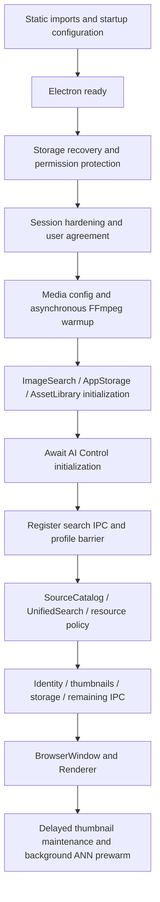

# Performance analysis — 2026-11-07

## Confirmed bottlenecks

1. Thumbnail queue applied the 24ms coalescing delay after every completed batch, even when more work was already waiting. Actual native-IPC A/B plus reverse testing confirmed a repeatable throughput gain from draining queued batches immediately. Initial coalescing and bounded concurrency remain.
2. Retained image and video search pages each polled model status every 15 seconds while hidden. Measured eight calls in 31 seconds with both mounted; visibility-aware polling removes them, while event subscription and explicit task refresh remain. Scoped React Profiler commits fell 10 to 6.

## Investigated without production changes

Six lazy panels are preloaded by App.tsx after 2.4 seconds through idle scheduling. All six preserve hidden state. Full/search-only/demand strategies were measured; apparent demand-only memory gains did not survive alternating-order/settling verification. Original strategy retained.

Hidden page unloading is unsafe without moving local queries/results and task ownership into durable state. No automatic unmount introduced. Store subscriptions, broad render hotspots and large-array IPC require additional profiling; no speculative global memoization.

Main imports include ImageSearch, AppStorage, AssetLibrary, SourceCatalog and UnifiedSearch services. Existing startup phase instrumentation was reused. FFmpeg warmup already runs asynchronously. Static import count alone does not establish blocking; fine-grained module/service timing and initialization dependency tracing remain incomplete. Security, agreement, data recovery and IPC ordering were not changed.

## Interpretation and priority

The matched three-run comparison does not establish startup or memory improvement. Sampled peak working set increased 4.65 MiB; post-switch settled median increased 6.56 MiB. Previous alternating preload runs had much larger GC/timing variation, so this is not proof of a leak, nor a memory reduction claim. Monitor sustained memory trends in the packaged soak.

Five-minute CPU pair was 0.191% to 0.088% of one core; one pair is insufficient for a broad CPU claim. The direct hidden-call count is stronger evidence of removed redundant work.

Priorities: finish packaged longevity/exit acceptance; monitor retained-page trends; add service-level profiling before startup deferral; obtain representative real-media and judged text data before accuracy claims. Read PERFORMANCE_REPORT.md for exact measurements and limitations.

## Startup and retained-page audit details

The existing startup phases (three original runs, process.uptime clock) were: main-module-loaded 414–439 ms, electron-ready 441–466 ms, agreement-checked 448–473 ms, services-registered 715–747 ms, window-created 757–786 ms, renderer-loaded 905–945 ms. The agreement-to-registration block was 267–278 ms, but includes multiple services and awaited AI Control initialization. It does not isolate any single culprit. Smoke isolation excludes actual user-directory migration and does not measure a fresh real-user agreement interaction.

| Area | Observed lifecycle | Consequence |
|---|---|---|
| Image/video search | Task progress listeners survive hidden pages; cleanup on unmount. Model polling now visibility-gated. | Keep task listeners; do not unload local results. |
| Source catalog | Recursive two-second polling gated by isVisible; cancellation and unsubscribe in cleanup. | Already avoids hidden polling. |
| Asset library assets | 100-item page, virtual grid, active gate invalidates hidden requests; 200ms query debounce cleared. | No full 10,000-node DOM; preserve user query/selection. |
| Asset library tasks / duplicates | Event subscriptions with cleanup, rather than continuous idle polling. | Background task events are required. |
| Unified search | Query debounce/keyboard listeners with cleanup; subscriptions belong to controller hooks. | No speculative blanket memoization. |
| Storage location | One initial status request, mounted guard; no periodic timer. | Not an idle timer bottleneck. |
| Automatic maintenance section | Five-second status interval once section mounted. CollapsibleSearchSection retains its body after first expansion. | Follow-up measured six hidden calls/31s; visibility gating now verified, including draft scopes and hidden task completion. |
| Data editor | 500ms timer only during rebuild/stop or scoped folder edit; scoped timer cleared in finally. | Preserve operation completion/cancellation semantics. |
| ANN/semantic/recall workers | Existing lazy creation, idle disposal and explicit dispose paths; suspend handlers release search workers. | Further lifetime/large-payload tracing required before changes. |

This is a source audit, not dynamic proof that every listener and worker is leak-free. Follow-up measurements accepted two further variables: FFmpeg warmup yielding/cancellation and automatic-maintenance UI visibility polling.

## Measured startup service timings

Three isolated development starts, temporary AST instrumentation restored afterward; no operation skipped/reordered. Evidence: artifacts/benchmark/runtime-memory/startup-services-2PqMLO/report.json.

| Service | Median | Timing boundary |
|---|---:|---|
| hardenDataDirectoryPermissions | 0.09 ms | awaited completion |
| ensureAccepted | 4.87 ms | awaited completion |
| initMediaToolConfig | 3.91 ms | synchronous call only |
| warmFfmpegStatusCache | 80.41 ms | synchronous call only |
| initImageSearchService | 3.87 ms | synchronous call only |
| initAppStorageService | 0.04 ms | synchronous call only |
| initAssetLibraryService | 37.36 ms | synchronous call only |
| initAiControlApi | 0.39 ms | awaited completion |
| loadProfiles | 0.07 ms | synchronous call only |
| initSourceCatalogService | 15.65 ms | synchronous call only |
| initUnifiedSearchRuntime | 69.31 ms | synchronous call only |
| getAssetIdentityService | 0.08 ms | synchronous call only |
| createWindow | 52.78 ms | synchronous call only |

FFmpeg returns a Promise but performs significant synchronous work before its first suspension. The previously recorded description of asynchronous warmup did not imply a non-blocking invocation. The subsequent ABBA yield experiment consistently improved block medians, and the guarded candidate passed lifecycle/regression checks; the yield strategy was accepted. Static import evaluation is still not attributed per module. Existing smoke safety excludes real data migration/permission-hardening cost.

## Fifth accepted variable: real-gallery cached preview initialization

The real-gallery matrix found a UI-cache scheduling issue rather than a substantial disk-cache read cost. Loaded data was already in the bounded Renderer LRU, but newly mounted virtual cards started blank while deferLoading blocked the lookup. Initializing/resetting from the matching cached path/size lets existing previews display during scroll, with no new IPC. Unknown paths and uncached sizes remain deferred. Source and cached output hashes are identical.

Three runs/variant at 1k/5k/10k (18 native scenarios) reproduced 1.8% to 100% warm-scroll preview-element readiness and approximately 131–138ms to 14ms cached-position return. This is a visual-readiness improvement, not a frame-rate or memory reduction. In the 5k cohort P95 frame interval increased from 9.7 to 13ms and sampled working-set peaks increased 10–25MiB across cohorts. See PERFORMANCE_REAL_GALLERY.md for exact scopes, the separate cold-open follow-up and the eight existing sampled BMP failures. No decoding quality, image dimensions, queue bounds or search behavior changed.
