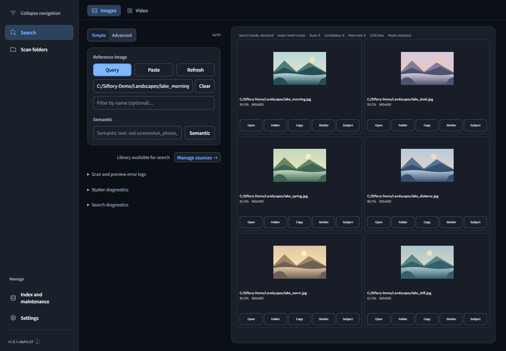
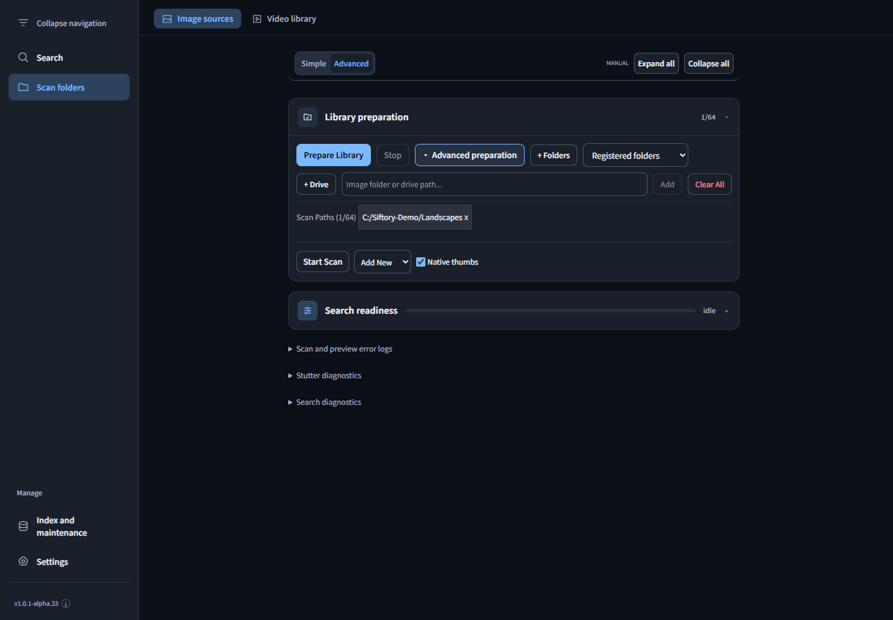

# Siftory · 寻藏

[简体中文](README.md) | **English**

**A local-first desktop application for image and video search and media management.** Drop a reference image into the window, find similar candidates in your indexed library, then open the original file or its folder.

**Windows x64 · v1.0.1-alpha.33 · Apache-2.0**

[Download](https://github.com/kaliwell/Siftory/releases/tag/v1.0.1-alpha.33) · [Release notes](docs/current/2026-11-14-alpha33-image-search-workflow.md) · [Report an issue](https://github.com/kaliwell/Siftory/issues) · [Developer documentation](docs/README.md)

Some linked documentation is currently available in Chinese only.

## Interface

These screenshots show the current Alpha33 source interface using an isolated demo profile. The library, images, similarity scores and timings are examples, not measurements of retrieval quality or performance. No private media or paths are shown.

**Image search: reference images, semantic queries, thumbnail results and file actions.**



**Library preparation: add folders, prepare indexes or expand individual preparation steps.**



## Features

- **Image similarity search:** match a reference image against your local index. Simple and Advanced interfaces offer Fast, Standard and Precise search modes.
- **Drop images anywhere:** drag a local image onto any content area of the window to search. You can also select a file or paste an image from the clipboard.
- **Browser image drops:** import an image URL or image data from a browser, then search with the imported reference. Images behind login, hotlink protection or inaccessible source URLs may fail; try copying and pasting the image, or save it locally first.
- **Text and video search:** find media using natural language, filenames and other conditions. Video frame indexes help locate relevant frames. The corresponding models and resources, including FFmpeg where needed, must be configured first.
- **Index maintenance:** configure scan folders, run incremental scans, generate thumbnails, check sources, back up and restore data, and clean up derived data.
- **Search diagnostics:** distinguish model loading, query-image processing, cache validation and construction, index loading and retrieval. Progress uses stage-specific units such as MiB/s and records/s.

Local library search runs on your computer. Browser image imports download the referenced image over the network, and model downloads and resource setup also require network access. Siftory does not provide cloud library hosting.

## Download and installation

The current release is **[1.0.1-alpha.33, a prerelease](https://github.com/kaliwell/Siftory/releases/tag/v1.0.1-alpha.33)**.

1. Download the [Windows x64 Online installer](https://github.com/kaliwell/Siftory/releases/download/v1.0.1-alpha.33/Siftory-1.0.1-alpha.33-Windows-x64-Setup.exe), or visit the Release page for notes and validation reports.
2. Before upgrading, exit the previous version normally and back up application data and original media as described in [Alpha backup and recovery](BACKUP_SAFETY.md). Then run the installer.
3. To verify the download, use the accompanying [SHA256SUMS.txt](https://github.com/kaliwell/Siftory/releases/download/v1.0.1-alpha.33/SHA256SUMS.txt).

**The Online installer does not bundle AI models.** Download, install or configure models separately. Reuse of existing models and data depends on the current configuration and file validation results.

## First use

1. Open **Scan folders** in the sidebar and add the image or video folders you want to search.
2. Select **Prepare Library**, follow any model setup prompts and wait for indexing to finish. In Advanced mode, expand **Advanced preparation** to run individual steps such as scanning.
3. Switch to **Search**. Drop a reference image into the window, select a file, paste an image or enter a semantic query. Open a matching file, reveal its folder or continue searching for similar files.

See the [user manual](docs/reference/user-manual.md) for more details. It includes historical sections; use the screenshots here and the actual application for current navigation.

## Status and validation scope

Siftory is in Alpha. Features, the interface, index formats and compatibility may change. The current local installer passed archive, runtime-resource and isolated startup checks. Full upgrade testing, native cross-window dragging from different browsers and retrieval quality on real media still require validation.

Alpha33's GitHub CI native-index check passed. The source-quality job failed when an older UI test waited for a retired navigation entry. See the [Release notes and attached reports](https://github.com/kaliwell/Siftory/releases/tag/v1.0.1-alpha.33). Investigation of slow first searches is tracked in [Issue #1](https://github.com/kaliwell/Siftory/issues/1); the cause of the original roughly 19-second wait has not been confirmed.

## Development

Requirements: Windows x64, Git, Node.js **24.22.1**, npm **11.19.1**, Python and the Visual Studio C++ build tools required by the native module.

Check out the Alpha33 tag to use the source corresponding to the installer; the default branch may still contain an earlier application version:

```powershell
git clone --branch v1.0.1-alpha.33 https://github.com/kaliwell/Siftory.git
cd Siftory
git switch -c dev/local-alpha33
npm ci
npm run build:native
npm run build:native:electron
npm run dev
```

Common validation commands:

```powershell
npm run typecheck
npm run lint
npm run format:check
npm run test:architecture
npm run test:core-behavior
npm run build:renderer:checked
```

The full `npm test` suite, video tests and installer builds require additional runtime resources. Pinned versions and hashes are listed in the [runtime resource manifest](resources/runtime-manifest.json). Place FFmpeg and FFprobe in `tools/ffmpeg/bin/` and verify them with:

```powershell
npm run resources:fetch -- --verify-only --component=gyan-ffmpeg-full-8-1-2
```

Some license and resource checks also require `legal/covered-source/canvas-rust-sources.zip`, matching its adjacent manifest. Model weights, runtime databases, development dependencies, installers and local test logs are excluded from normal source commits. See [CONTRIBUTING.md](CONTRIBUTING.md) for collaboration guidelines.

## License

Copyright 2026 **kaliwell**. Original project source and documentation are licensed under the **[Apache License 2.0](LICENSE)**. Contributors retain copyright in their respective contributions.

See [source licensing](SOURCE_AVAILABILITY.md) and [NOTICE](NOTICE) for scope and attribution. Third-party code, dependencies, fonts, tools and models retain their own licenses. See the [component inventory](THIRD_PARTY_COMPONENTS.md), [Node dependency inventory](NODE_THIRD_PARTY_COMPONENTS.md) and [third-party notices](THIRD_PARTY_NOTICES.md).

## Feedback

When opening a [GitHub issue](https://github.com/kaliwell/Siftory/issues), include the application version, Windows version, reproduction steps, expected and actual behavior, and redacted screenshots or logs. For model-related issues, include the model name and CPU/GPU backend. Remove accounts, tokens, private paths and media you are not authorized to share.
