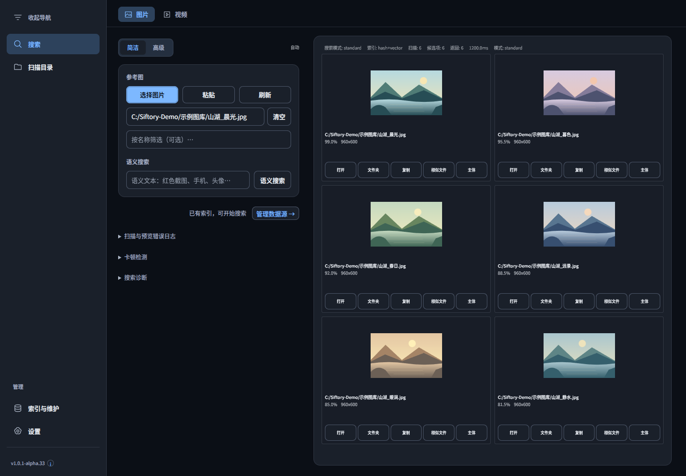
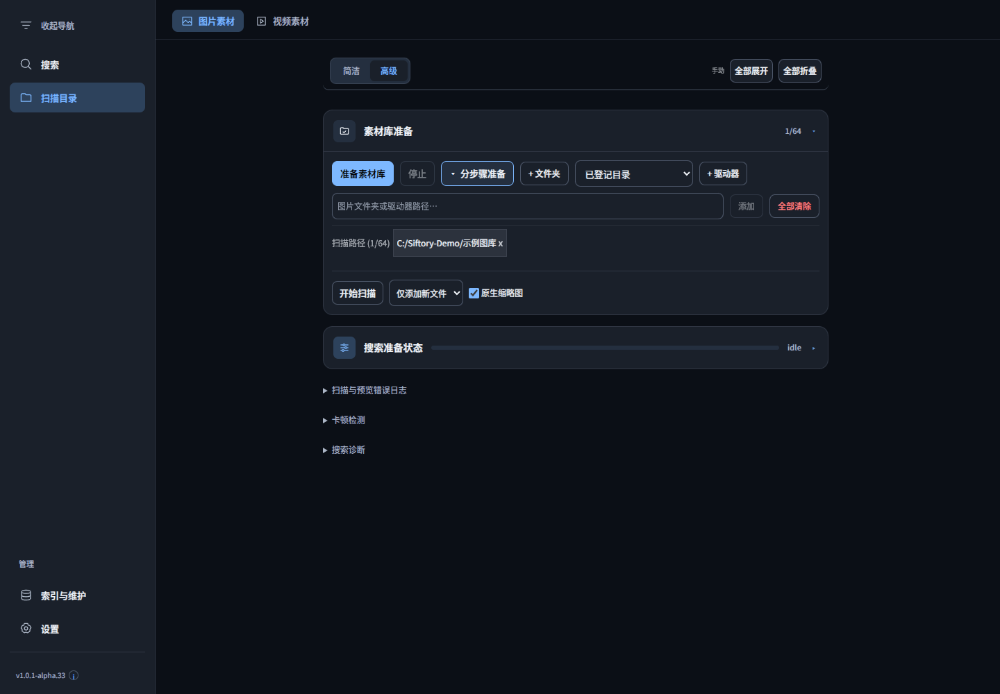

# Siftory · 寻藏

**简体中文** | [English](README.en.md)

**本地优先的图片、视频检索与素材管理桌面软件。** 将参考图片拖入窗口，在已建立索引的素材库中寻找相似候选，再打开原文件或所在文件夹。

**Windows x64 · v1.0.1-alpha.33 · Apache-2.0**

[下载安装包](https://github.com/kaliwell/Siftory/releases/tag/v1.0.1-alpha.33) · [更新记录](docs/current/2026-11-14-alpha33-image-search-workflow.md) · [反馈问题](https://github.com/kaliwell/Siftory/issues) · [开发文档](docs/README.md)

## 界面预览

以下截图来自 Alpha33 当前源码界面，使用独立演示配置。图库、图片、相似度分数与耗时均为示例，不代表真实检索质量或性能；不包含私人素材或路径。

**图片搜索：参考图片、语义搜索、缩略图结果与文件操作。**



**素材库准备：添加目录、准备索引，或展开分步骤操作。**



## 主要功能

- **以图搜图**：参考图与本地图片索引匹配，支持简洁／高级界面及快速、标准、精准检索模式。
- **全窗口拖图**：将本地图片拖入窗口任意内容区域即可搜索；也可选择图片或粘贴剪贴板图片。
- **网页图片拖入**：接收浏览器图片地址或图片数据，导入临时查询图片后搜索。需要登录、有防盗链限制或无法取得原始图片的网页可能失败，可改用复制图片后粘贴，或保存到本地再拖入。
- **文字与视频检索**：通过自然语言、文件名等条件查找素材；视频可建立帧索引并定位相关画面。相应模型和 FFmpeg 等资源需准备完成。
- **索引与维护**：配置扫描目录、增量扫描、缩略图生成、来源检查、备份恢复及派生数据清理。
- **搜索诊断**：区分模型加载、查询图片处理、缓存校验与构建、索引读取和实际检索；按阶段显示 MiB/s 或条/s 等单位。

本地图库检索在本机运行。网页图片导入会联网下载对应图片，模型下载等资源准备也需要网络；本项目不提供云端图库托管。

## 下载与安装

当前发布版本为 **[1.0.1-alpha.33 预发布](https://github.com/kaliwell/Siftory/releases/tag/v1.0.1-alpha.33)**。

1. 下载 [Windows x64 Online 安装包](https://github.com/kaliwell/Siftory/releases/download/v1.0.1-alpha.33/Siftory-1.0.1-alpha.33-Windows-x64-Setup.exe)，或到 Release 页面查看更新说明与验证报告。
2. 升级前正常退出旧版，并按 [Alpha 数据备份与恢复规则](BACKUP_SAFETY.md) 备份应用数据及原始素材，再运行安装向导。
3. 如需核验下载文件，使用 Release 附带的 [SHA256SUMS.txt](https://github.com/kaliwell/Siftory/releases/download/v1.0.1-alpha.33/SHA256SUMS.txt)。

**Online 包不捆绑 AI 模型。** 模型需自行下载、安装或在软件中配置；已有模型与数据是否可复用，以当前配置及文件校验结果为准。

## 第一次使用

1. 打开左侧 **扫描目录**，添加需要检索的图片或视频目录。
2. 点击 **准备素材库**，按提示准备模型并等待索引任务完成。高级模式下可展开 **分步骤准备** 单独执行扫描等操作。
3. 切换到 **搜索**，将参考图片拖入窗口，或使用选择图片、粘贴、语义搜索入口。找到候选后可打开文件、定位文件夹或继续查找相似文件。

更多操作见 [用户说明书](docs/reference/user-manual.md)。该文档包含历史版本章节，当前入口以本 README 的界面截图和软件实际显示为准。

## 当前状态与验证范围

项目处于 Alpha 阶段，功能、界面、索引格式和兼容性仍可能调整。当前版本的本地安装包归档、运行资源和隔离启动检查已通过；完整覆盖安装、不同浏览器的原生跨窗口拖动及真实素材检索效果仍需测试。

Alpha33 的 GitHub CI 原生索引检查通过；源码质量任务在旧界面测试等待已撤下的入口时失败。详情和验证附件见 [Release 说明](https://github.com/kaliwell/Siftory/releases/tag/v1.0.1-alpha.33)。首次搜索缓慢的诊断进展见 [Issue #1](https://github.com/kaliwell/Siftory/issues/1)，尚未确认原始约 19 秒等待的根因。

## 开发运行

需要 Windows x64、Git、Node.js **24.22.1**、npm **11.19.1**，以及编译原生模块所需的 Python 和 Visual Studio C++ 构建工具。

以下命令检出与安装包对应的 Alpha33 标签，避免默认分支仍处于较早版本：

```powershell
git clone --branch v1.0.1-alpha.33 https://github.com/kaliwell/Siftory.git
cd Siftory
git switch -c dev/local-alpha33
npm ci
npm run build:native
npm run build:native:electron
npm run dev
```

主要检查命令：

```powershell
npm run typecheck
npm run lint
npm run format:check
npm run test:architecture
npm run test:core-behavior
npm run build:renderer:checked
```

完整 `npm test`、视频测试和安装包构建还需要相应运行资源。资源版本和哈希见 [运行资源清单](resources/runtime-manifest.json)；FFmpeg／FFprobe 位于 `tools/ffmpeg/bin/`，可使用以下命令验证：

```powershell
npm run resources:fetch -- --verify-only --component=gyan-ffmpeg-full-8-1-2
```

部分许可证与资源检查还要求准备 `legal/covered-source/canvas-rust-sources.zip`，并匹配同目录清单。模型、运行数据库、开发依赖、安装包和本地测试日志不进入普通源码提交。协作约定见 [CONTRIBUTING.md](CONTRIBUTING.md)。

## 开源许可

Copyright 2026 **kaliwell**。项目原创源码和文档采用 **[Apache License 2.0](LICENSE)**，贡献者保留其各自贡献的权利。

许可适用范围见 [开源许可说明](SOURCE_AVAILABILITY.md) 和 [NOTICE](NOTICE)。第三方代码、依赖、字体、工具及模型保留各自许可证，详见 [第三方组件清单](THIRD_PARTY_COMPONENTS.md)、[Node 依赖清单](NODE_THIRD_PARTY_COMPONENTS.md) 和 [第三方声明](THIRD_PARTY_NOTICES.md)。

## 问题反馈

请在 [GitHub Issues](https://github.com/kaliwell/Siftory/issues) 中提供软件版本、Windows 版本、复现步骤、预期与实际行为，以及脱敏截图或日志。模型相关问题请注明模型名称和 CPU／GPU 后端；提交前去除账户、令牌、私人路径和未经授权的素材。
