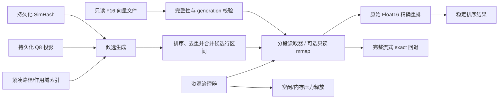

# 运行内存与峰值内存完整优化 TODO

> 状态：当前  
> 实施状态：自动实施中；Phase 0 除 RMO-005 外已验证，Phase 1/2 工程主线已验证；全量工程门禁已于 2026-09-02 在当前工作树复验通过；accepted GPU 环境基线已由不可变三轮证据恢复，正式三轮工作负载仍需通过 RAM/GPU 静默预检  
> 更新日期：2026-09-02  
> 范围：Electron 主进程、Renderer、GPU/Utility 进程、ANN/F16 搜索缓存、DINO/CLIP 建库子进程、视频帧索引、用户模型运行时、资源回收与固定硬件回归  
> 前置文档：[内存与资源生命周期自动优化 TODO](2026-08-18-memory-lifecycle-auto-todo.md)  
> 性能基线：[PxHere 1000 张首次建库三轮正式基线](../benchmark/2026-08-26-fixed-hardware-first-build-baseline.md)  
> 替代文档：无

## 快速入口

- [当前结论](#1-当前结论)
- [目标、非目标和禁止方案](#3-目标与非目标)
- [量化目标与现有硬门禁](#4-提议目标与现有硬门禁)
- [完整任务队列](#6-完整自动任务队列)
- [固定硬件场景矩阵](#7-固定硬件场景矩阵)
- [执行顺序与停止条件](#8-执行顺序与停止条件)
- [完成定义](#12-完成定义)

## 1. 当前结论

当前仍有明确且可量化的内存优化空间，但本轮采样没有发现持续上涨式泄漏。主要问题不是 Renderer，而是图片向量搜索会在 ANN Worker 中完整读取并保留当前模型的 Float16 向量快照。

2026-08-28 对真实运行实例的只读采样得到：

| 指标 | 当前证据 | 说明 |
| --- | ---: | --- |
| Electron 进程组稳定工作集 | 约 1.04 GiB | 主进程、Renderer、GPU、Utility 合计 |
| Electron 进程组启动/搜索后首个采样工作集 | 约 1.16 GiB | 包含约 125 MiB 暂态工作集 |
| 主进程稳定工作集 | 约 627–630 MiB | 连续 50 秒采样无持续增长 |
| 主进程私有提交 | 约 703–705 MiB | 更接近完整向量 Buffer 的实际承诺量 |
| Renderer 工作集 | 约 171–174 MiB | 当前不是首要目标 |
| GPU 进程工作集 | 约 181–186 MiB | 不通过关闭硬件加速换取下降 |
| 系统物理内存 | 15.63 GiB | 当前目标硬件 |
| 系统可用内存 | 约 4.34 GiB | 当前采样时约 72.2% 已使用 |

当前真实缓存还表明：

- `dinov2_vitb14__global.f16` 为 652.7 MiB，445,575 行、768 维。
- `clip_vit_base_patch32__global.f16` 为 374.8 MiB，383,840 行、512 维。
- DINO/CLIP 路径索引分别约 59.8 MiB 和 54.9 MiB。
- DINO SimHash 派生文件约 3.4 MiB；既有 Q8 投影验证的投影本体约 53.77 MiB。
- `electron/vectorAnnWorker.ts` 当前通过 `fs.readFileSync(cache.vectorPath)` 读取整个 F16 文件，并在 `LoadedAnnIndex.vectors` 中保留。
- `electron/vectorAnnWorkerHost.ts` 已有 5 分钟空闲退出机制，但缺少可审计的创建、活动、计时和释放事件；当前采样不能证明所有路径都按期释放。
- `electron/mediaSearchFrameIndex.ts` 已把帧向量缓存限制为 256 MiB，但预算只累计向量 `byteLength`，没有包含 Map、路径字符串和对象开销。
- DINO/CLIP 批处理会并行解码一批原始 RGB 图片；超大原图和两个模型重叠时仍可能形成短时内存峰值。
- 当前 legacy `vector_index_manifest.json` 仍记录 385,637 条，而 DINO F16 metadata 已记录 445,575 条；内存预算和基准必须以实际打开的 authoritative/cache handle 为准，不能采用过期 legacy 计数。

固定硬件首次建库三轮基线为：主进程 RSS P50/P95 `647.05/687.50 MiB`，模型子进程聚合 RSS P50/P95 `3099.95/3317.94 MiB`，综合 RSS P50/P95 `3747.00/3951.75 MiB`，最低系统空闲内存 `1350.56 MiB`。该基线使用隔离用户数据和 1000 张图片，不能代替真实 44 万向量搜索基线。

## 2. 承接关系与不重复整改

[前置内存生命周期 TODO](2026-08-18-memory-lifecycle-auto-todo.md) 中的 `MEM-001`–`MEM-010` 已完成，覆盖远程传输历史、选择令牌、快捷方式缓存、Watcher、媒体图片 LRU、缩略图维护、Renderer 同步存储、隐藏组件和回调释放。本计划不重新打开或复制这些任务，只承接该文档明确未覆盖的 Native/GPU/模型运行时、RSS 回落解释和长时真实建库 soak。

新任务使用 `RMO-*` 命名，是为了区分“已完成的通用生命周期整改”和“尚未实施的跨进程内存架构优化”；二者不存在状态覆盖关系。

收益预测仅用于排序，不能代替 A/B：移除完整 DINO F16 常驻预计可降低主进程约 450–580 MiB；建库解码/队列/模型重叠治理预计可降低综合峰值约 0.5–1.0 GiB；视频帧索引收益取决于实际帧数，必须分别在 10 万和 50 万帧规模测量。任何候选没有达到性能、精度和恢复门禁时都应被拒绝，即使单项内存数字更低。

## 3. 目标与非目标

### 3.1 目标

1. 降低图片搜索后的主进程常驻内存，优先移除完整 F16 快照常驻。
2. 降低 DINO/CLIP 首次建库综合峰值，并保留现有吞吐、断点续建和 ready 语义。
3. 为 ANN、视频帧索引、用户模型和 Renderer 建立统一的所有者、预算、空闲释放和退出清理规则。
4. 建立可复现的分进程、分阶段、连续三轮固定硬件内存基线。
5. 保持源素材只读、搜索精度、结果排序、模型、向量格式、回退路径和用户现有功能不变。

### 3.2 非目标和禁止方案

以下方式即使能降低数字，也不作为可接受优化：

- 不更换 DINO/CLIP 模型，不降低向量维度，不把最终 Float16 精确评分改成近似评分。
- 不把 ANN 候选比例从已验证的 20% 继续下调，除非重新通过 Recall 门禁。
- 不取消完整精确扫描回退，不改变 scope、正负反馈、主体搜索或稳定 tie-break 语义。
- 不关闭 GPU/DirectML、透明窗口或动画来伪造内存收益。
- 不通过降低图片质量、减少视频抽帧、跳过模型或延迟 ready 提交来降低峰值。
- 不修改或删除真实素材、模型、向量、索引和人工元数据。
- 不把磁盘缓存大小当作运行内存，也不把 Windows 工作集波动直接认定为泄漏。
- 不依赖频繁强制 GC 作为生产方案；强制 GC 只允许用于受控测试归因。

## 4. 提议目标与现有硬门禁

以下“优化目标”是本 TODO 的候选目标，只有在固定硬件连续三轮通过后才能升级为新控制线。现有正式控制线在此之前不得放宽。

| 场景/指标 | 现有证据或控制线 | 提议优化目标 | 判定方式 |
| --- | ---: | ---: | --- |
| 真实 DINO 热搜索后主进程工作集 P95 | 当前约 630 MiB | ≤420 MiB 且相对下降 ≥30% | 同库、同查询、三轮冷/热配对 |
| 真实 DINO 热搜索后进程组工作集 P95 | 当前约 1.04 GiB | ≤850 MiB 且相对下降 ≥20% | 同 PID 角色聚合 |
| ANN 正常空闲释放 | 设计为 300 秒 | 300 秒内释放 ≥80% ANN 所有内存 | 记录 worker 生命周期与释放前后私有提交 |
| 内存压力下 ANN 释放 | 尚无门禁 | 60 秒内释放；不得中断活动搜索 | 注入资源水位，不模拟 OOM |
| 空闲恢复后的主进程 | 尚无隔离基线 | ≤启动稳定 P95 + 128 MiB | 搜索结束后 5/10 分钟采样 |
| ANN 热查询 P95 | PREP-007 约 960 ms | 不高于配对基线 5% | 50 个分层查询，三轮 |
| ANN 冷查询 P95 | 需重新采集 | 不高于配对基线 5% 或绝对增加 50 ms，取更宽者 | SSD/HDD 分开记录，不合并 |
| ANN 平均/最差 Recall@50 | 99.88% / 98% | ≥99.5% / ≥96% | 复用 PREP-007 样本 |
| 查询图 Top-1 一致率 | 100% | 100% | 与完整 Float16 exact 比较 |
| 首次建库 Library Ready P95 | 当前 270172.98 ms；正式控制线 ≤297190.28 ms | ≤283681.63 ms（当前值 +5%） | 三轮 1000 图，配置 identity 完全一致 |
| 首次建库三轮极差 | 正式控制线 ≤15% | ≤15%，目标 ≤10% | 不删除异常轮，环境无效需整组三轮重跑 |
| 首次建库主进程峰值 | 正式控制线 ≤790.63 MiB | 不放宽；目标 ≤650 MiB | 三轮 1000 图 |
| 首次建库子进程聚合峰值 | 正式控制线 ≤3815.63 MiB | 候选目标 ≤2900 MiB | 三轮 1000 图 |
| 首次建库综合峰值 | 正式控制线 ≤4544.51 MiB | 候选目标 ≤3400 MiB | 三轮 1000 图 |
| 建库最低系统空闲内存 | 正式控制线 ≥1012.92 MiB | 候选目标 ≥1536 MiB | 全阶段连续采样 |
| 600 次面板生命周期 | 后 400 轮约 83 KiB 波动 | 不退化；无单调增长 | 测试构建强制 GC 前后比较 |
| 搜索/取消 soak | 尚无正式门禁 | 100 轮后私有提交 ≤预热后 +96 MiB | 生产 GC 策略，等待 10 分钟回收 |
| 2 小时混合 soak 后 2/3 窗口 | 尚无正式门禁 | 进程树 Private Bytes 斜率 ≤0.5 MiB/min | 三轮独立运行，不能删除异常轮 |
| Renderer 强制 GC 后 heap | 旧 UI 文档记录平台期 | 斜率 ≤0.25 MiB/min，2 小时总增量 ≤16 MiB | 仅测试构建通过 CDP 触发 GC |
| 句柄/线程/DOM/listener | 尚无统一门禁 | 相对稳定检查点增长 ≤max(20,5%) | 分角色和 Renderer 记录 |
| 详细遥测开销 | PREP-011 时间开销 +0.149% | 时间 ≤1%，RSS ≤16 MiB | 遥测开/关配对 |

正式报告中的绝对应急预算（主进程 2048 MiB、子进程 4801.36 MiB、综合 5601.59 MiB、系统空闲至少 256 MiB）只用于防止失控运行，不是优化验收线，也不能用来替代上表更严格的控制线。

## 5. 目标架构



目标状态只常驻小型 SimHash、Q8 投影、必要的 scope 元数据和最近候选页；完整 Float16 数据仍是最终精确评分的唯一事实源，但不再以一个 652.7 MiB Buffer 长期驻留。

第一实现候选应优先使用纯 Node 的有界 `FileHandle.read`/`readv`：候选行先排序，再把连续或相邻行合并成块读取。只有纯 Node 方案无法同时通过内存与 P95 门禁时，才进入只读 mmap/Native SIMD 影子实现；Native 候选必须额外通过越界、截断、损坏文件、并发 generation 切换和 fuzz 门禁。

## 6. 完整自动任务队列

状态统一使用 `待做`、`进行中`、`已验证`、`拒绝`、`阻塞`。当前仅形成计划，以下实现任务全部为 `待做`。

### Phase 0：证据、预算与可观测性

| 顺序 | ID | 任务 | 依赖 | 状态 | 验收标准 |
| ---: | --- | --- | --- | --- | --- |
| 0 | RMO-000 | 修复 `automation:performance-baseline -- --plan` 的模块循环依赖并恢复只读计划入口 | - | 已验证 | plan/compare 真实执行退出 0；`validateRound` 独立模块可复用；新增循环依赖回归测试 |
| 1 | RMO-001 | 新增 Windows 递归进程树内存采样器，识别 main/renderer/GPU/utility/worker/model child | - | 已验证 | 100–500 ms 可配置；记录 PID/PPID/创建时间、WS、Private Bytes、Commit、page fault、线程、句柄、CPU、系统空闲 RAM；PID 重用安全 |
| 2 | RMO-002 | 增加主进程 V8 `heapUsed/external/arrayBuffers`、ANN 所有字节、Renderer CDP 与缓存预算快照 | RMO-001 | 已验证 | 能区分 JS heap、Buffer/TypedArray、DOM/listener、模型子进程与 GPU；不得记录用户路径 |
| 3 | RMO-003 | 为 startup、prewarm、search、rerank、idle、dispose、decode、preprocess、inference、commit 建立关联事件 | RMO-002 | 已验证 | 每个任务有 `runId/stage/model/provider/pid`；日志有界轮转；单行与总量均有限制 |
| 4 | RMO-004 | 建立冷启动、冷/热图片搜索、文本搜索、视频单文件/文件夹、首次建库、取消和 100 轮 soak 场景编排 | RMO-003 | 已验证 | 失败后继续收集其余阶段；报告明确 `passed/failed/incomplete`，不能把缺字段当通过 |
| 5 | RMO-006 | 建立正式运行 preflight、AB/BA/AB 配对顺序和环境污染判定 | RMO-001 | 已验证 | AC/Turbo、静默 10 分钟、可用 RAM ≥4 GiB、Commit ≤75%、无残留产品进程、GPU 初始占用在基线 +256 MiB 内；污染则整组三轮重跑 |
| 6 | RMO-005 | 固化当前代码的连续三轮内存基线和机器/数据/实现 identity | RMO-000,RMO-004,RMO-006 | 待做 | 隔离 userData；真实大库仅只读；计数取实际 authoritative/cache handle 并报告 legacy mismatch；接受指针原子更新；保存原始 JSONL 与摘要 |
| 7 | RMO-007 | 让资源治理器看到完整 Electron 指标、受管后代 Private Bytes 和真实 GPU VRAM | RMO-001 | 已验证 | 不再只使用主进程 RSS；跨平台缺指标安全降级；采样抖动有 hysteresis；压力注入可驱动统一决策 |

### Phase 1：生命周期和低风险回收

| 顺序 | ID | 任务 | 依赖 | 状态 | 验收标准 |
| ---: | --- | --- | --- | --- | --- |
| 8 | RMO-010 | 将 ANN Worker 生命周期改为显式状态机并记录空闲计时原因 | RMO-003 | 已验证 | `absent/loading/active/idle/disposing` 可观测；重复释放幂等；迟到消息不能复活旧 worker |
| 9 | RMO-011 | 验证并修复所有成功、取消、错误、抢占和队列替换路径的空闲释放 | RMO-010 | 已验证 | 每条终止路径均安排或完成释放；无活动请求时 300 秒内退出；线程/句柄回归基线 |
| 10 | RMO-012 | 增加内存压力感知的提前释放，不中断活动搜索 | RMO-011 | 已验证 | 低空闲 RAM 时 60 秒内退出空闲 worker；正常内存仍保留热查询窗口；无常驻轮询 |
| 11 | RMO-013 | 收紧启动预热：仅预热当前可用 generation 和实际主搜索模型 | RMO-010 | 已验证 | 暴露 resident key；DINO+CLIP 同存时无 supersede storm；无 authoritative generation 时零读取；低内存、建库运行或前台搜索时不启动竞争预热 |
| 12 | RMO-014 | 补齐 generation 切换、派生数据重置、模型切换、应用退出和系统挂起的显式释放 | RMO-010,RMO-011,RMO-012,RMO-013 | 已验证 | 旧向量/路径/投影引用均不可达；退出不因 worker 或定时器挂起 |

### Phase 2：ANN 分页精确重排——最大收益主线

| 顺序 | ID | 任务 | 依赖 | 状态 | 验收标准 |
| ---: | --- | --- | --- | --- | --- |
| 13 | RMO-020 | 抽象只读 F16 snapshot reader，支持 base+committed delta 和按行批量读取 | RMO-005 | 已验证 | 严格长度、维度、代次、尾哈希和 chunk proof；越界/短读/变化立即失败关闭 |
| 14 | RMO-021 | 将确定性 Q8 投影作为带 identity 和完整性证明的派生 sidecar 持久化 | RMO-020 | 已验证 | 内容与当前内存构建逐字节一致；原子提交；损坏/过期自动重建；可安全删除重建 |
| 15 | RMO-022 | 对候选行排序、去重并合并相邻区间，建立有界页缓存 | RMO-020 | 已验证 | 读取字节和缓存字节均可计量；取消可抢占；页缓存受条目与字节双预算约束；复合 base+delta 不使用全量 `Buffer.concat` |
| 16 | RMO-023 | 精确重排改为候选向量分块读取，移除 `LoadedAnnIndex` 的完整 F16 Buffer | RMO-021,RMO-022 | 已验证 | 最终分数与当前 Float16 精确重排逐位/容差一致；热搜索主进程达到内存目标 |
| 17 | RMO-024 | 将路径索引改为 UTF-8 字符串表+偏移或等价紧凑结构，并支持 scope 过滤 | RMO-020 | 已验证 | Windows 大小写、Unicode、移动路径、active scope 和 acceptPathKeys 语义完全一致 |
| 18 | RMO-025 | 保留热追加、metadata-only、delta-only 和 64 段上限语义 | RMO-021,RMO-024 | 已验证 | 追加只读取 committed delta；前缀/代次/完整性变化强制安全重建；不改源向量 |
| 19 | RMO-026 | 为分页 ANN 保留完整流式 exact 回退和影子比较开关 | RMO-023,RMO-025 | 已验证 | ANN 不可用、结果不足、损坏、取消或 feature flag 关闭时行为与当前回退一致 |
| 20 | RMO-028 | 移除查询期百万级 Map/Set/全量评分复制，使用紧凑行状态与 bounded heap/quickselect | RMO-023,RMO-024 | 已验证 | Top-K 与稳定 tie-break 完全一致；候选内存 O(candidate/topK)；每 1024 行取消检查不退化 |
| 21 | RMO-027 | 完成 DINO、CLIP、NekoSearch 与主体/反馈 scope 的三轮质量和性能门禁 | RMO-014,RMO-026,RMO-028 | 已验证 | CLIP/DINO 各 200 查询三轮 rank-equivalent Recall@50 与 Top-1 等价率均为 1；整树 Private 峰值最差 1853.78 MiB；Neko Top-1/Top-50 一致、P95 改善 43%、scope 零违规；真实源前后不变 |

### Phase 3：DINO/CLIP 首次建库峰值

| 顺序 | ID | 任务 | 依赖 | 状态 | 验收标准 |
| ---: | --- | --- | --- | --- | --- |
| 22 | RMO-030 | 在模型子进程按批记录 RSS、Private Bytes、external、解码像素和临时 Tensor 字节 | RMO-003 | 已验证 | DINO/CLIP/Provider 分开统计；遥测默认摘要化且开销通过门禁 |
| 23 | RMO-031 | 将解码并发从“图片数量”扩展为“图片数量+预计 RGB 字节”双预算 | RMO-030 | 已验证 | header-first 校验总像素/长边；80 MP、1:100 panorama 自动降并发；普通图片吞吐和损坏回退不变 |
| 24 | RMO-032 | 影子验证“在 Sharp 内直接缩放/裁剪到模型尺寸后再 raw”，拒绝未经 parity 的替换 | RMO-030 | 进行中 | 默认关闭的诊断入口、边界张量与 16 图完整建库摘要 parity 已通过；完整报告汇总兼容与真实报告回放已验证；1000 图 AB/BA/AB 自动门禁已实现，但记录时空闲 RAM 3.19 GiB 未过 4 GiB 预检，未启用候选 |
| 25 | RMO-033 | 让资源治理器按实时整树 RAM/VRAM 决定 DINO/CLIP 重叠、批次和 worker 数 | RMO-007,RMO-030,RMO-031 | 已验证 | 5 秒实时整树/VRAM 快照与 2 入 3 出迟滞已接入；16 GiB 高/中余量保持 2 worker，低余量降为 1/4，恢复后扩回；无效遥测 fail-closed，活动批次与流式队列不丢失 |
| 26 | RMO-034 | 模型阶段完成、取消、失败和切换后及时关闭不再需要的 child/provider | RMO-033 | 已验证 | 断点和已提交结果保留；活动批次不被误杀；子进程、Pipe、定时器和 GPU session 均释放 |
| 27 | RMO-035 | 审计 Buffer/Tensor 所有权并减少主子进程间重复复制 | RMO-030 | 已验证 | 安全使用 Buffer view/transfer/二进制 framing；不得产生 use-after-transfer、Base64 膨胀或扩大输出行上限 |
| 28 | RMO-037 | 将 preparation existing/candidates/inputs/selectedJobs/tasks/taskQueue 改成 ACK/反压流式窗口 | RMO-003 | 已验证 | 父进程最多保留 1–2 个批次；百万路径堆保持平台；cursor/ledger 支持取消恢复且无丢失/重复 |
| 29 | RMO-036 | 在固定 1000 图上完成 jobs/batch/重叠策略的三轮配对矩阵 | RMO-032,RMO-033,RMO-034,RMO-035,RMO-037 | 待做 | 综合峰值达到候选目标；Library Ready P95 不回退 5%；向量和索引 parity 通过 |

### Phase 4：视频、用户模型、Renderer 与 GPU

| 顺序 | ID | 任务 | 依赖 | 状态 | 验收标准 |
| ---: | --- | --- | --- | --- | --- |
| 30 | RMO-040 | 修正视频帧索引缓存预算，纳入 Map、对象、路径字符串和 ArrayBuffer 所有权 | RMO-002 | 已验证 | 估算与进程 external/私有提交趋势吻合；预算不再只统计 `vector.byteLength`；单索引超限时允许不缓存 |
| 31 | RMO-041 | 为视频帧索引增加单模型 LRU、空闲释放和内存压力释放 | RMO-040 | 已验证 | 单视频与文件夹搜索结果一致；两个模型切换不长期双驻留；活动搜索不被淘汰 |
| 32 | RMO-042 | 评估二进制 F16/Q8、SQLite 固定宽记录或分片流式 Top-K，移除生产同步全量 JSONL 读取 | RMO-041 | 已验证 | 10 万/50 万帧影子比较；实际缓存不超预算；若 P95、跳转帧或 Top-K 不通过则拒绝 |
| 33 | RMO-043 | 把用户模型 ONNX Native Session、Tensor IPC 和运行时纳入统一字节预算 | RMO-002,RMO-007 | 已验证 | Session 使用 byte-LRU；压力时显式 release；二进制 framing 避免 Base64 多次复制；保留模型大小、输出行、请求超时和 5 分钟退出边界 |
| 34 | RMO-044 | 审计搜索结果缩略图、Blob/Object URL、Data URL LRU 和虚拟网格回收 | RMO-002 | 已验证 | 600 次打开/关闭和 100 次同进程真实搜索通过；结果摘要稳定、源索引只读、最终内存显著低于峰值；对象 URL revoke 与 128 MiB LRU 专项测试通过 |
| 35 | RMO-045 | 单独建立 GPU 进程与 VRAM 基线，不以关闭加速作为候选 | RMO-001 | 进行中 | 记录透明窗口、缩略图、播放器、DINO/CLIP 各场景；只处理可证明的纹理/Surface 生命周期问题 |
| 36 | RMO-046 | 将视频帧 manifest 的全量读写/多份 Map 规划改为 SQLite 或 append+compaction 流式索引 | RMO-040 | 已验证 | 100 万 manifest 行的计数/预览/find 不读取整文件；崩溃恢复一致；峰值随窗口而非总行数增长 |
| 37 | RMO-047 | 收敛缩略图 GPU BrowserWindow/WebGL context 与大图 in-flight 字节 | RMO-007,RMO-045 | 进行中 | 比较 1/2/8 lanes 的 10k 混合大图；验证后关闭不必要的 `preserveDrawingBuffer`；画面一致且吞吐不越门禁 |

### Phase 5：故障、压力、发布与文档闭环

| 顺序 | ID | 任务 | 依赖 | 状态 | 验收标准 |
| ---: | --- | --- | --- | --- | --- |
| 38 | RMO-053 | 在 360 存在的真实环境记录版本、实时防护状态和采样噪声 | RMO-005 | 已验证 | 不自动关闭 360、不添加排除项；三轮异常离散时标记环境无效而非放宽门禁 |
| 39 | RMO-050 | 建立 1000 次固定查询、600 次面板生命周期、2 小时混合 soak 与每周 8 小时诊断 | RMO-005,RMO-027,RMO-036,RMO-041,RMO-042,RMO-043,RMO-044,RMO-045,RMO-046,RMO-047,RMO-053 | 进行中 | 1000 次固定查询已通过（后 2/3 私有内存斜率 −0.084 MiB/min、结果摘要稳定、源只读）；仍需正式 2 小时混合 soak 三轮与每周 8 小时诊断 |
| 40 | RMO-051 | 覆盖取消、暂停、子进程崩溃、短读、磁盘满、generation 切换和应用退出 | RMO-027,RMO-036,RMO-042,RMO-043,RMO-046,RMO-047 | 已验证 | 原子状态可恢复；无脏 sidecar；无孤儿进程；下一次任务能正常重试 |
| 41 | RMO-052 | 验证真实素材和缓存只读边界、日志脱敏与输出目录隔离 | RMO-050,RMO-051 | 进行中 | 三轮质量门禁的 9 个真实输入前后大小、mtime、抽样 SHA-256 均不变，报告隔离且采样无路径；仍等待正式首次建库/混合 soak 闭环 |
| 42 | RMO-054 | 执行 TypeScript、Lint、格式、专项测试、Native fuzz、UI、打包资源和完整 verify | RMO-050,RMO-051,RMO-052 | 进行中 | 2026-09-02 当前工作树完整 verify 已通过（含 Native 重编译、82 项 Native/fuzz 和 checked build）；依赖 RMO-050/052 完成后再终态验收，不构建发布包冒充通过 |
| 43 | RMO-055 | 接受新的固定硬件三轮内存控制线并更新文档/机器可读指针 | RMO-054 | 待做 | 三轮 identity 一致、无异常值删除、控制线不可静默放宽；旧报告保留可追溯 |

## 7. 固定硬件场景矩阵

每个正式场景独立执行三轮；冷、暖状态不得混为一组。三轮 P50 为中位数，P95 取三轮最大值。任何一轮受到后台任务、360 异常扫描、温度、电源或残留进程污染时，废弃并重跑整个三轮组，不允许只删除最差轮。

| 场景 | 固定动作 | 主要证据和门禁 |
| --- | --- | --- |
| M0 首次图片建库 | 1000 张 PxHere、隔离 userData、DirectML、既有 accepted tuple | Ready、主/子/同时点整树峰值、系统空闲、向量/索引 parity、源只读 |
| M1 Packaged 冷/暖空闲 | 空 profile 与成熟 synthetic profile 分组；采样 5 分钟，覆盖 120 秒缩略图维护 | 整树 WS/Private、Renderer heap、线程/句柄进入平台；冷暖报告分开 |
| M2 UI 生命周期 | 预热 5 次，再进行 600 次图片/视频面板打开、关闭、展开和折叠 | CDP heap、DOM、listener、整树 Private Bytes、Object URL 与 LRU 预算 |
| M3 搜索与缓存抖动 | 固定 seed/query manifest，1000 次图片、文本、统一搜索并穿插预览 | 结果 digest 完全一致；无重复模型初始化；稳态斜率、缓存和 ANN 预算通过 |
| M4 取消/失败/恢复 | 在 25%/50%/75% 循环取消建库、缩略图和媒体任务，再重启恢复 | 10 秒内无残留后代；Watcher/任务/端口回到基线；索引可恢复；零 crash/OOM |
| M5 视频与模型会话 | 8-profile 固定语料，每 profile 至少 3 次 load/generate/dispose；同时覆盖单视频和文件夹 | sidecar/端口关闭；Private Bytes/VRAM 无线性增长；结果和跳转帧合法 |
| M6 混合 soak | 搜索 60%、UI churn 20%、取消恢复 10%、播放/用户模型 10%，每轮 2 小时、共三轮 | 后 2/3 窗口斜率、终点增量、进程/句柄清理；每周另跑单次 8 小时诊断 |
| M7 内存压力恢复 | 注入资源治理器快照或使用隔离 Job Object，不用无界 ballast 吃满宿主机 | 两个采样周期内降并发/停后台；前台仍可用；零 OOM；压力解除后队列继续并回落 |
| M8 规模上限 | 合成 100 万路径、100 万×768 composite 向量以及 10 万/50 万视频帧，不读取真实私有内容 | 峰值按预算而非规模线性失控；空闲回落；增量/切代/损坏恢复；topK/Recall parity |

所有场景的 sampler error、timeline 截断、结果 digest 差异、素材/模型/源码 identity 变化、崩溃、OOM 和残留后代进程均为零容忍。RSS 没有立即下降不能单独判定泄漏，必须与 Private Bytes、GC 后 heap、对象/句柄计数和后 2/3 时间窗斜率联合判断。

## 8. 执行顺序与停止条件

推荐执行顺序：`Phase 0 → Phase 1 → Phase 2 → Phase 3 → Phase 4 → Phase 5`。

1. Phase 0 没有完成前，不接受任何“节省了多少内存”的结论。
2. Phase 1 可以独立落地，但不能把更短空闲时间造成的首次搜索变慢冒充无代价优化。
3. Phase 2 是最大收益主线。先实现纯 Node 分段读取，再决定是否需要 Native mmap。
4. Phase 3 每个候选必须独立 A/B；只要 ready P95、向量 parity 或错误恢复失败，就回退该候选，不把多个变化一起合并判断。
5. Phase 4 不阻塞 Phase 2，但最终综合内存基线必须覆盖图片、视频和用户模型。
6. 任一阶段出现搜索质量下降、源数据变化、孤儿进程、无法恢复的 sidecar 或超过现有正式控制线，立即停止默认启用并回退 feature flag。

## 9. 计划新增的测试与命令

以下命令属于计划接口，尚未实现时不得写成已通过：

```powershell
npm.cmd run test:runtime-memory
npm.cmd run benchmark:memory -- --plan
npm.cmd run benchmark:memory -- --scenario=image-search --runs=3
npm.cmd run benchmark:memory -- --scenario=video-single --runs=3
npm.cmd run benchmark:memory -- --scenario=ui-churn --runs=3 --cycles=600
npm.cmd run benchmark:memory -- --formal --scenario=dino-fused-shadow --runs=1 --dataset=D:\PxHereDataset\images\pxhere-000000
npm.cmd run benchmark:memory -- --formal --scenario=thumbnail-matrix --runs=3 --dataset=D:\PxHereDataset\images\pxhere-000000
npm.cmd run benchmark:memory -- --formal --scenario=mixed-soak --runs=3 --duration-min=120
npm.cmd run benchmark:memory:mixed-soak:weekly -- --plan
npm.cmd run benchmark:memory:scale
npm.cmd run test:runtime-memory:faults
npm.cmd run benchmark:first-build-memory -- --dataset=D:\PxHereDataset\images\pxhere-000000
npm.cmd run benchmark:first-build-memory:promote -- --plan --dataset=D:\PxHereDataset\images\pxhere-000000
```

应继续复用的现有门禁：

```powershell
npm.cmd run test:vector-ann
npm.cmd run benchmark:vector-ann:prep007
npm.cmd run benchmark:neko-search:prep008
npm.cmd run benchmark:search-library-preparation
npm.cmd run benchmark:image-search:preparation:ab
npm.cmd run benchmark:media-search:preparation:ab
npm.cmd run automation:performance-baseline -- --plan
npm.cmd run verify
```

正式基准的输入 `D:\PxHereDataset\images\pxhere-000000` 只读，输出只能进入 `artifacts/benchmark/runtime-memory/<run-id>`。测试必须记录应用版本、Git/dirty identity、Node/Electron、Provider、模型哈希、数据集 identity、Windows、GPU、驱动、内存、360 状态和环境变量；任一关键 identity 缺失则报告 `incomplete`。

`automation:performance-baseline -- --plan` 必须在 RMO-000 修复后才能作为有效入口。`benchmark:search-library-preparation` 会维护自己的 `latest.json`，正式内存诊断必须传入隔离输出并禁止改写既有 accepted/latest 指针。WPR/WPA 只用于门禁失败后的归因，其高开销 ETL 不进入正式三轮统计。

## 10. 回滚与兼容设计

1. 分页精确重排、持久化 Q8、紧凑路径索引和资源治理器分别使用独立内部 feature flag，便于单项影子和回滚；不得暴露成普通用户需要理解的永久选项。
2. 新 sidecar 只保存可重建派生数据，采用版本号、源 identity、完整性证明、临时文件、`fsync` 和原子重命名。
3. 旧 F16/路径缓存保持只读兼容；新版本失败时可以删除新 sidecar 并回到当前 ANN/流式 exact 路径。
4. 回滚不能回退用户向量 generation、删除模型或覆盖人工元数据。
5. Native mmap 若进入候选，必须保留纯 Node 实现和 `FLOATING_CLOCK_DISABLE_VECTOR_ANN=1` 的完整 exact 安全出口。

## 11. 风险清单

| 风险 | 影响 | 缓解 |
| --- | --- | --- |
| 候选向量随机读取导致 HDD P95 回退 | 搜索变慢 | 行号排序、连续区间合并、预读页、SSD/HDD 分开门禁 |
| scope 过滤依赖完整路径 Map | 内存收益被路径抵消或结果错误 | 紧凑字符串表/偏移；Unicode、大小写、移动路径专项 parity |
| generation 在读取中切换 | 混合新旧向量 | 固定 handle identity、前后 proof、短读失败关闭、原子 sidecar |
| mmap/Native 越界或悬挂映射 | 崩溃或安全问题 | 纯 Node 优先；Native 仅影子；边界测试、fuzz、退出卸载 |
| 全量查询 Map/评分数组抵消分页收益 | 搜索仍出现百 MB 峰值 | 紧凑行状态、bounded heap/quickselect，并单独统计候选阶段峰值 |
| preparation 多份全库路径队列 | 百万文件时主进程堆线性增长 | ACK/反压流式窗口、持久化 cursor、取消恢复 parity |
| ONNX Native Session 不受 V8 heap 限制 | 用户模型可能越过 512 MiB 表面上限 | Native RSS 字节 LRU、显式 release、整树预算和恶意大 Tensor fail closed |
| 多个隐藏 WebGL context 和大图并发 | Renderer/GPU RAM/VRAM 同时冲高 | 共享 1–2 lane、全局 in-flight 字节、上传前缩小、画面 parity |
| 提前释放造成频繁冷启动 | 搜索延迟抖动 | 正常/压力双阈值、最近模型热窗口、三轮冷/热 P95 |
| 解码前缩放改变模型输入语义 | 搜索精度下降 | 默认关闭；严格向量/Top-K/EXIF/Alpha/JPEG parity，不通过即拒绝 |
| DINO/CLIP 错峰降低建库吞吐 | ready 变慢 | 只在低内存水位降级；高余量保留并行；5% P95 门禁 |
| 只看工作集误判释放 | 错误结论 | 同时记录 Private Bytes、V8 external、worker 所有字节和系统空闲内存 |
| 360 扫描造成离散数据 | 基准不可比较 | 记录状态但不自动关闭；离散超限标记环境无效并重跑 |

## 12. 完成定义

只有同时满足以下条件，本文才能从“实施计划”更新为“已验证”：

1. RMO-000 和任务表列出的全部适用项均为 `已验证`；被拒绝候选有独立证据且不进入默认路径。
2. 真实 44 万级图片库的 DINO/CLIP 冷/热搜索连续三轮通过内存、P95、Recall、Top-1、scope 和 exact 回退门禁。
3. PxHere 1000 图首次建库连续三轮通过 ready、主/子/综合 RSS、系统空闲、向量 parity、索引完整性和源只读门禁。
4. 视频单文件、视频文件夹、文本搜索、主体搜索、NekoSearch、用户模型和 600/100 轮 soak 均无功能或生命周期回退。
5. `npm.cmd run verify`、Native fuzz、双语 UI、打包资源验证全部通过。
6. 文档、机器可读报告、接受指针和旧基线的追溯关系完整；没有把单次本机采样写成发布保证。

## 13. 执行身份与工作区边界

| 字段 | 当前值 |
| --- | --- |
| 执行系统 | Codex |
| 所有者 | Codex/root |
| 模型信息 | GPT-5 系列；精确版本未公开 |
| 协作代理 | Codex 运行时只读审计代理；不拥有目标文档写权限 |
| 外部代理 | 无已确认的本任务外部代理 |
| 文档入口 | `docs/README.md` |
| 工作区状态 | Git 工作树存在大量既有未提交改动；本任务只新增本 TODO，并最小更新相关文档入口 |
| 事实优先级 | 当前代码与本次只读采样 > 当前文档 > 历史报告 |
| 数据边界 | 不修改真实素材、模型、索引和用户数据；优化仅修改仓库代码、测试、文档和隔离的 `artifacts/benchmark/runtime-memory` 证据 |

## 14. 2026-08-29 正式编排补强

- 正式 preflight 与场景总入口现在都从 `artifacts/benchmark/fixed-hardware-first-build/latest.json` 解析不可变 accepted 报告，再稳定重读三轮原始报告并核对路径边界、字节数、SHA-256、硬件 identity 和显存基线离散度。当前证明为 `1060 MiB`，三轮范围 `1036–1060 MiB`，接受报告 SHA-256 为 `29a34b9300b0aa673bec55632735799ac5bab70eb93768b967723b166673bfe2`。这只解决 GPU 环境参照，不替代 RMO-005 对当前代码重新建立三轮完整内存基线。
- `thumbnail-matrix` 已进入正式场景总入口：正式模式强制每档 `10,000` 图，按 `1/2/8` jobs 固定顺序执行；三档必须全部走 GPU、零 CPU 回退、零缓存写入失败、源不变且证据目录隔离，否则失败关闭。
- `dino-fused-shadow` 已进入正式场景总入口：固定 `1000` 图与三轮 `AB/BA/AB`，严格核对扫描、DINO、CLIP 摘要、六轮顺序、DirectML/生命周期子门禁和源只读证明。候选仍默认关闭，只有完整矩阵通过后才能决定是否启用。
- 缩略图矩阵在每个外层正式轮次前执行 10 分钟预检；DINO 子矩阵则在三次 `AB/BA/AB` 配对轮各自开始前执行预检，并把三份 accepted GPU 证明写进报告。任一轮污染会让对应整组成为 `incomplete`，不会执行后续重负载。单独 preflight 入口也不再接受任意手填显存数冒充正式基线。
- 当前只读计划确认两个场景均已就绪；正式多场景按场景独立预检与整组失效，编排、preflight、缩略图与 DINO 专项共 `35` 项测试通过。随后真实正式入口回放在预检阶段分别观测到约 `0.75/0.66 GiB` 可用物理内存、`1776/1788 MiB` GPU 占用与最高 `75.24%` Commit；两个场景均为 `incomplete`，DINO `completedMatrixEntries=0`，没有启动 Electron 建库或修改用户数据，因此不改变 RMO-005/036/047/050/052/055 的终态。
- preflight 对 AC 断开、任一样本 RAM `<4 GiB`、Commit `>75%` 或残留产品进程这类已经使整轮必败的条件会记录 `earlyTermination` 并立即停止等待；成功或仍可能恢复的 CPU/磁盘/GPU 静默判断仍必须采满 10 分钟，门槛没有缩短或放宽。
- RMO-055 的显式接受入口已实现为 `benchmark:first-build-memory:promote`：候选三轮中的每一轮都先执行独立 10 分钟正式 preflight，再绑定运行开始时的 accepted 摘要，并通过硬件/数据集/配置/原始证据/源只读校验；任何性能或内存上限变宽、最低空闲内存下限降低、接受指针竞态或历史链断裂都会失败关闭。成功时只通过临时文件原子替换机器可读指针，旧报告仍由 `previous` 链完整保留。promotion/ledger 隔离用例 `59/59` 通过且 `--plan` 已通过，但在新的正式三轮证据产生前不会更新当前指针，因此 RMO-055 仍为待做。
- RMO-050 的每周 8 小时固定入口为 `benchmark:memory:mixed-soak:weekly`，强制正式 preflight、单轮 `480` 分钟和既有 `60/20/10/10` 工作负载比例；`--plan` 不写证据。当前环境未通过 RAM/GPU 静默门禁，因此尚未把一次计划检查记作 8 小时运行完成。

## 15. 2026-09-02 当前工作树复验

- `npm.cmd run test:runtime-memory` 为 `72/72` 通过；`npm.cmd run test:runtime-memory:faults` 为 `95/95` 通过，覆盖采样、预检、场景编排、搜索/混合 soak、规模矩阵、缩略图矩阵、质量门禁、资源压力、解码预算以及 ANN/子进程故障恢复。
- QA 可达性门禁发现五个新测试文件未进入 `npm test` 的递归入口；现已将数据目录权限测试纳入 `test:guards`，将源文件同步、向量失效 outbox、源缩略图清理和向量维护协调测试纳入 `test:vector-pipeline`。可达性门禁 `8/8`、五组定向回归 `44` 通过、`1` 项 POSIX 环境跳过。
- 主进程依赖图复验为 `302` 个模块。新增的两个节点分别是可复用的数据目录权限边界和诊断脱敏边界；架构门禁保留二者的独立职责，并把上限精确锁定在已审查的 `302`，未设置余量。分层检查扫描 `488` 个模块，无跨层导入。
- 固定硬件证据脚本重构后遗留的不可达包指纹采集链及一个测试包装函数已删除；对应证据/ledger 专项回归 `35/35` 通过。随后在最终代码上重新执行完整 `npm.cmd run verify` 成功：TypeScript、Lint（`0` error、`0` warning）、格式、全部测试、Native 重编译、`82/82` Native/fuzz、Renderer/Electron 构建和 checked-build 体积门禁均通过。
- 同日完整验证后的快速只读预检观测到可用物理内存 `2,009,686,016 B`（约 `1.87 GiB`）、总内存 `16,781,979,648 B`、Commit 比例 `69.66%`、GPU 占用 `2910 MiB`、GPU P95 `89%`、AC 供电正常、残留产品进程为 `0`。失败项为可用 RAM `<4 GiB` 和 GPU 未静默；因此没有启动正式 1000/10k/2 小时/8 小时负载，没有关闭用户程序，也没有修改真实素材、模型、索引或用户数据。RMO-005/032/036/045/047/050/052/055 的终态保持不变。
