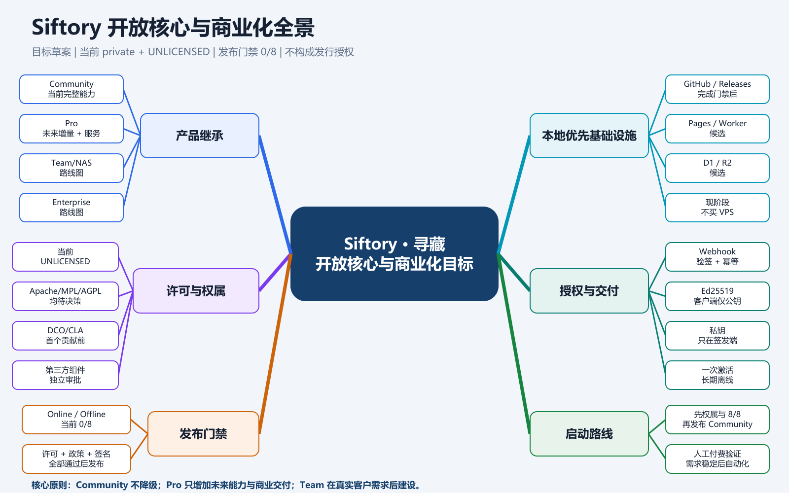
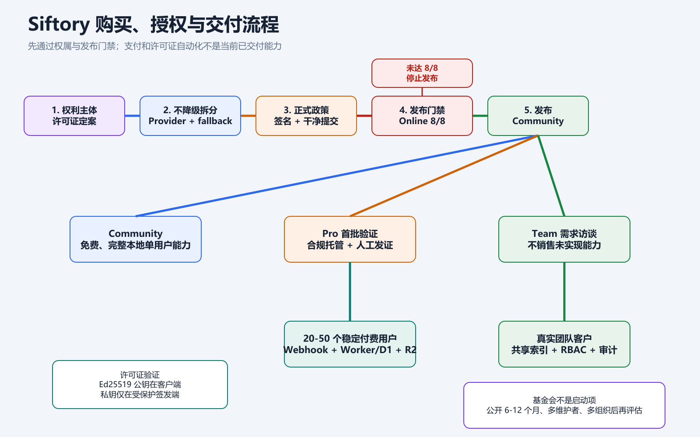

# Siftory 开放核心与商业化落地方案

> 版本：1.1  
> 状态：目标草案，未经项目许可证、商业发布和法律审批  
> 更新日期：2026-08-24  
> 适用项目：Siftory · 寻藏（品牌法律清查仍待完成）  
> 当前事实源：`package.json`、`legal/license-decisions.json`、`legal/commercial-release-decisions.json`、`docs/current/2026-08-17-commercial-release-readiness.md`  
> 关联策略：`docs/current/2026-08-19-open-source-commercialization-foundation-strategy.md`  
> 边界：本文是产品、工程和运营目标，不构成许可证批准、法律意见、税务意见、支付平台准入承诺或正式发行授权。

---

## 1. 执行结论

项目适合采用“完整可用的 Community + 未来新增的 Pro + 尚待建设的 Team/Enterprise”路线，但当前不能直接开源或商业发布。

正确顺序是：

> 权利主体与许可证决策 → 不降级地建立版本边界 → 完成正式政策与签名 → 发布门禁达到 8/8 → 发布 Community → 人工验证付费 → 自动授权 → 有真实团队客户后建设 Team/NAS。

### 1.1 当前必须保持的边界

- 当前仓库仍为 `private: true`、`license: UNLICENSED`，项目许可证决策仍是 `proprietary/pending`。
- AGPL、MPL、Apache 或双重许可均是待批准候选，不是当前许可证。
- 当前图片搜索、自然语言搜索、精排、主体搜索、视频关键帧、GPU、批处理等能力位于同一主项目中，没有 Community/Pro 权益隔离。
- 不允许为了形成 Pro 而直接删除、隐藏或降低现有功能与性能。必须先建立公开能力接口、兼容实现、数据迁移和完整回归。
- Team/NAS 当前只有网络目录等基础能力，没有共享索引服务、组织、席位、邀请、RBAC 或团队授权系统。
- 支付、License Key、Ed25519 激活、Worker/D1/R2 交付目前是目标架构，尚未实现为生产系统。

### 1.2 当前发布判定

截至 2026-08-24，`npm.cmd run release:readiness` 的 Online 与 Offline 均为 `0/8`。阻断项包括：

1. 项目与随包组件许可证未批准。
2. 工作区不是干净、可追溯的发布提交。
3. 缺少与发布提交绑定的版本 Tag。
4. 未配置受保护的 Authenticode 生产签名。
5. Neko 搜索基线尚不可比较。
6. 缺少与当前提交绑定的 packaged matrix。
7. 最终隐私政策尚未批准。
8. 最终安全、更新与支持政策尚未批准。

门禁状态必须通过命令重新读取，不能用本文替代：

```powershell
npm.cmd run release:readiness -- --profile=online
npm.cmd run release:readiness -- --profile=offline
npm.cmd run licenses:gate -- --profile=online
npm.cmd run licenses:gate -- --profile=offline
```

---

## 2. 产品与收入结构

下表区分“当前已有能力”和“未来商业权益”，避免把路线图写成已完成功能。

| 版本       | 当前状态               | 应保留或新增的价值                                                      | 收费建议                       |
| ---------- | ---------------------- | ----------------------------------------------------------------------- | ------------------------------ |
| Community  | 目标公开版本，尚未发布 | 保留当前完整的单机本地工作流，不人为限制图库数量                        | 免费开源，许可证待决定         |
| Pro        | 尚未形成独立 SKU       | 未来新增 OCR、高级 Provider、受控优化运行时、专业工作流、官方更新与支持 | 首批用户验证价，最终价格待实验 |
| Team/NAS   | 路线图                 | 共享索引、组织、成员、席位、权限、审计、集中备份和 NAS 协作             | 有真实团队客户后年付           |
| Enterprise | 路线图                 | 私有部署、离线模型、策略控制、定制集成、长期支持和 SLA                  | 单独报价                       |

### 2.1 Community：不降级的完整基础闭环

Community 应至少保留当前已经存在的单机用户价值：

- 本地、挂载网络和当前已接线远程来源的扫描、增量索引和稳定素材身份。
- 以图搜图、自然语言检索、重复与近重复发现。
- 当前可用的分层召回、颜色/形状精排和结果筛选。
- 当前可用的主体/局部、人脸和 ReID 检索入口及安全的模型缺失降级。
- 当前可用的视频关键帧索引、图/文搜视频、统一检索和本地播放器联动。
- 素材库、集合、分类/标签、元数据筛选、个人备份与恢复。
- 批量重命名、模型检测与导入、派生数据清理和存储维护。
- ANN/F16/Native/worker 和 CPU/DirectML/CUDA Provider 接口及精确回退。
- 本机 loopback AI Control API；它是单用户集成，不等于 Team API/MCP。

Community 不能成为演示壳，也不能通过人为图库上限迫使个人用户付费。模型权重、专有运行时和工具是否随包，仍由逐组件许可证和发行 Profile 决定。

### 2.2 Pro：以未来增量和交付质量收费

适合作为 Pro 的能力应是未来新增或可清晰隔离的商业价值：

- 生产级高级 OCR、版面理解和组合条件检索。
- 新的 local-feature、专业模型 Provider 和经许可批准的优化运行时包。
- 专业批处理、规则编排、计划任务、导出预设和可复用工作流包。
- 官方签名安装包、稳定兼容矩阵、优先构建和受控更新通道。
- 专业支持、迁移工具、诊断包和长期版本维护。

现有多向量召回、颜色/形状、主体、视频关键帧、GPU 和批处理已经深度接入主项目。拆分前必须保持公开接口和 Community 兼容实现，不能直接抽走。

### 2.3 Team/NAS 与 Enterprise

Team/NAS 只有在以下能力真实完成并经过多用户一致性、安全和恢复测试后才能销售：

- 共享索引服务和并发写入协议。
- 组织、成员、邀请、席位和角色权限。
- 审计日志、共享素材库、任务冲突、备份恢复和管理员工具。
- NAS/远程源策略、离线冲突处理和集中升级。
- 团队 API/MCP、Webhook、许可证、合同、发票和支持流程。

Enterprise 在 Team 能力之上增加隔离网部署、SSO/AD/SCIM、HA/DR、数据驻留、定制模型、策略控制、SLA 和长期支持。当前不得把这两档描述成已经交付。

### 2.4 定价原则

- 价格是实验，不是本文批准的商业承诺。
- 个人 Pro 可测试“一次购买当前大版本 + 一年更新”；更新权益到期后旧版本继续运行。
- 退款、终止和离线使用条款必须与最终 EULA、支付平台规则和许可证技术实现一致。
- Team 按年收费，Enterprise 按部署、定制、合规和支持成本报价。

---

## 3. 开源与商业许可证决策

### 3.1 当前状态

当前代码不是已授权的开源发布物。没有最终项目 `LICENSE`，也没有已批准的商业 EULA。项目许可证不能替代模型、FFmpeg、CUDA/cuDNN、Native addon、测试素材等第三方组件自己的权利判断。

### 3.2 候选方案

| 候选       | 优点                                 | 主要风险                               | 当前结论                     |
| ---------- | ------------------------------------ | -------------------------------------- | ---------------------------- |
| 保持专有   | 先验证付费点，边界最直接             | 社区信任和外部贡献弱                   | 可作为公开前过渡状态         |
| Apache-2.0 | 商业采用友好，含明确专利授权         | 第三方可闭源扩展并销售                 | 待评估                       |
| MPL-2.0    | 文件级修改需要回流，允许更大商业组合 | 文件边界需要长期治理                   | 待评估                       |
| AGPL-3.0   | 强网络 copyleft                      | 桌面、插件、企业集成和私有模块组合复杂 | 不是默认选择，需专项法律审查 |
| 双重许可   | 官方可提供商业授权                   | 必须持续拥有足够再许可权，CLA 成本高   | 真实需求出现后再决定         |

任何符合开源定义的许可证都允许商业使用。项目可依靠商标政策、官方签名、更新质量、服务和企业能力区分官方版本，不能给开源许可证附加“禁止第三方商业售卖”的限制。

### 3.3 贡献与再许可

- 若采用单一开源许可证并长期保持方向，可优先评估 DCO。
- 若计划双重许可、版权集中或未来向基金会转移，必须在首个外部核心贡献合入前完成 CLA/版权与再许可方案。
- `CONTRIBUTING.md`、`CODE_OF_CONDUCT.md`、`SECURITY.md`、`GOVERNANCE.md`、商标政策和公开 RFC 流程应在公开仓库前完成。
- AGPL 核心与私有插件、独立本地进程或 IPC 的组合边界必须由合格法律顾问结合实际实现判断。

---

## 4. 代码边界与迁移策略

### 4.1 当前事实

- 构建只有 `online`/`offline` 资源 Profile，没有 Community/Pro/Team 产品 SKU。
- Renderer、preload 和主进程直接注册现有图片、视频、主体、向量、GPU 和批处理功能，没有 entitlement 判断。
- 规划中的 `community/`、`plugin-sdk/`、`pro-packages/`、`team-server/` 目录尚不存在。

### 4.2 目标结构

以下是目标结构，不代表当前仓库已经完成拆分：

```text
project/
├── community/        # 公开客户端与完整单机基础闭环
├── core/             # 稳定数据格式、任务、检索与 Provider 接口
├── plugin-sdk/       # 公开、版本化的扩展协议
├── providers/        # 可替换的公开基础实现
├── pro-packages/     # 私有的未来增量 Provider 与专业工作流
├── team-server/      # 私有的组织、共享索引、权限与审计
└── release/          # 受保护的组装、签名、授权与发布设施
```

### 4.3 无功能回退的拆分步骤

1. 冻结当前可见功能、结果语义、索引格式和性能基线。
2. 为 OCR、Embedding、精排、主体、视频和加速建立版本化 capability/provider 接口。
3. 先把当前实现迁移为默认 Provider，保持 UI、IPC、数据和性能等价。
4. 为模型缺失、商业 Provider 缺失和旧数据建立 Community fallback。
5. 只把未来新增且边界清晰的 Provider/工作流放入 Pro。
6. 通过全量测试、索引兼容、升级/降级、离线运行和性能回归后再公开仓库。

---

## 5. 基础设施与支付

### 5.1 基础设施原则

检索、图片、视频、索引和模型默认留在用户电脑或客户 NAS。线上只处理订单、许可证、账户和必要交付记录。

| 能力             | 目标方案                                | 当前状态                  |
| ---------------- | --------------------------------------- | ------------------------- |
| 官网             | Cloudflare Pages 或等价静态托管         | 待建设                    |
| 社区源码与下载   | GitHub + Releases                       | 无 remote，待准备干净仓库 |
| 海外支付         | Paddle 主候选，Creem 备用               | 需完成商户准入与测试      |
| 国内支付         | 早期合规托管，稳定后支付宝/微信商户能力 | 待真实经营主体和平台审核  |
| 授权 API         | Cloudflare Workers                      | 未实现                    |
| 订单/许可证      | D1 或等价事务存储                       | 未实现                    |
| Pro 安装包与模型 | R2 或等价对象存储 + 受控下载            | 未实现                    |
| Windows 发行     | Authenticode 签名与时间戳               | 未配置生产签名            |

现阶段不需要为了本地检索和前 20 名付费用户购买 VPS。出现长期后台任务、固定 IP、复杂团队后台、自建国内支付或 Serverless 成本明显更高时再评估 VPS。

### 5.2 支付事实与限制

- Paddle 官方规则为按月出款，最低阈值通常为 US$100；官方列有 CNY 出款，但商户准入、实际可选币种和银行入账仍以 Dashboard、KYC 和开户行审核为准。
- Creem 当前文档显示：中国个人可使用支付宝、企业使用本地银行账户；支付宝存在单次和年度限额，平台费用、出款费和排期应在上线前重新确认。
- Lemon Squeezy 的直接银行出款名单当前没有中国大陆，可用性通常依赖 PayPal，因此不作为默认主通道。
- 每人每年等值 5 万美元是个人结售汇便利化额度，不是合法经营收入上限。真实经营收入仍需保存材料并由经办银行、税务和专业顾问确认处理方式。

### 5.3 分阶段收款

#### 0-20 名付费用户

- 先完成合法发布主体、EULA、隐私、退款、签名和许可证门禁。
- 使用明确支持数字软件的合规托管平台或人工合同流程。
- 人工核验订单、发证、退款和重发，不建设复杂后台。
- Team 页面只接受需求访谈和预约，不销售未实现能力。

#### 20-50 名稳定付费用户

- 接入经过商户审核的 Paddle/备用通道。
- 部署 Webhook 验签、幂等订单、Worker + D1 和受控 R2 下载。
- 自动签发许可证，提供重发、更新权益、退款和异常订单处理。

#### 出现真实团队客户

- 先签需求和试点范围，再建设组织、席位、RBAC、共享索引、审计与团队年付。
- 根据真实并发、存储和运维成本决定 Serverless、托管服务或 VPS。

---

## 6. 许可证与交付系统

### 6.1 许可证字段

```text
schema_version    # 许可证结构版本
key_id            # 签名公钥版本
license_id        # 不可重复的许可证标识
plan              # community / pro / team
license_expiry    # 使用权到期；买断版为空
updates_until     # 可获得更新的截止日期
seat_limit        # 席位或可选激活数量
features          # 明确、版本化的权益列表
issued_at         # 签发时间
order_id          # 对应订单
```

### 6.2 安全原则

- 只相信经过平台签名验证的 Webhook，不相信浏览器“支付成功”跳转参数。
- 对事件 ID 和订单 ID 做幂等处理，记录退款、拒付和重放。
- 使用 Ed25519 或等价的现代签名方案；客户端只内置公钥，签名私钥不得进入 Electron、Native addon、安装包、日志或仓库。
- 支持 `key_id` 和公钥轮换；签发服务使用受保护 Secret 和最小权限。
- 一次激活后可长期离线，不要求每天联网，不以强硬硬件指纹作为首发阻塞项。
- 必须明确退款后的处理：买断离线许可证无法可靠远程撤销时，可停止未来更新与下载，但不能在政策上承诺无法技术执行的即时禁用。
- 安装包和更新必须校验签名、版本、哈希、渠道和 `updates_until`。

---

## 7. 基金会与治理

当前不成立独立基金会，也不把单一主体控制的实体包装成社区中立。

只有同时出现以下信号后才启动基金会尽调：

- 项目公开运行至少 6-12 个月并完成至少两个可复核发布周期。
- 至少 3 名不受同一主体控制的活跃维护者。
- 维护者覆盖至少 2 个独立组织或利益方。
- 多个组织需要中立商标、仓库、规范或资金管理，并愿意持续投入。
- 创始人愿意把相应社区资产置于公开治理下。

达到条件后优先比较 Apache、Eclipse、Linux Foundation 等现有托管机制，而不是先注册独立法律实体。

---

## 8. 30 天整理与验证清单

### 第 1 周：决策和事实基线

- [ ] 明确真实版权/发布主体、公开联系渠道和目标地区。
- [ ] 决定继续专有、开放核心或全量开源的评估路径。
- [ ] 冻结“不降低现有功能与性能”的 Community 基线。
- [ ] 建立 Community/Pro capability 抽取清单，而不是直接移动代码。
- [ ] 逐项处理模型、FFmpeg、Native addon、CUDA/cuDNN 和测试素材许可。

### 第 2 周：正式政策和发布准备

- [ ] 完成最终 EULA、隐私、退款、安全、更新和支持政策。
- [ ] 完成品牌/商标与域名清查。
- [ ] 准备受保护的 Authenticode 签名环境。
- [ ] 清理工作区、提交历史、绝对路径、凭据和不应公开的素材。

### 第 3 周：产品边界和许可证原型

- [ ] 建立 capability/provider 接口与 Community fallback。
- [ ] 实现本地许可证验签原型，不接入真实生产私钥。
- [ ] 创建支付 Sandbox 商品并测试 Webhook 验签、重复通知和退款。
- [ ] 完成 Online-first 安装包与 packaged matrix。

### 第 4 周：受控验证

- [ ] 使 Online 发布门禁达到 8/8，再决定是否公开 Community。
- [ ] 邀请目标用户测试，不销售未实现的 Team 能力。
- [ ] 记录激活、留存、检索频率、失败原因和愿付价格。
- [ ] 只有出现稳定重复需求后才建设自动授权后台。

---

## 9. 风险控制

| 风险                    | 控制措施                                                 |
| ----------------------- | -------------------------------------------------------- |
| 把目标草案当成当前许可  | 机器决策文件和 release gate 是唯一发布事实源             |
| 直接抽走现有 Pro 功能   | 先建 Provider ABI、Community fallback、迁移和全量回归    |
| Community 过弱          | 保留完整单机搜索、视频、素材库和安全降级闭环             |
| AGPL 与私有模块组合风险 | 许可证定案和真实实现均交专业法律审查                     |
| 模型字段被误当法律批准  | 只以 `legal/license-decisions.json` 和 profile gate 为准 |
| 支付成功页伪造          | 只处理验签 Webhook，并做幂等与重放防护                   |
| 离线许可证无法退款撤销  | 在 EULA 和退款策略中明确可执行边界                       |
| 海外出款退汇            | KYC 主体、平台账户和入账账户同名，保留完整证据链         |
| 过早开发 Team/NAS       | 先获得真实团队试点与合同需求                             |
| 过早成立基金会          | 满足多维护者、多组织和持续治理触发条件后再评估           |

---

## 10. 图示

### 10.1 商业化全景



### 10.2 购买、授权与交付



---

## 11. 官方参考

1. [Paddle 数字产品销售流程](https://developer.paddle.com/get-started/how-paddle-works/digital-products)
2. [Paddle 定价](https://www.paddle.com/pricing)
3. [Paddle 出款周期和最低金额](https://www.paddle.com/help/manage/get-paid/when-and-how-do-i-get-paid)
4. [Paddle 本地币出款](https://www.paddle.com/help/manage/get-paid/can-i-be-paid-in-my-local-currency)
5. [Paddle 账户验证](https://www.paddle.com/help/start/account-verification)
6. [Creem 中国卖家出款](https://docs.creem.io/merchant-of-record/finance/payouts)
7. [Lemon Squeezy 支持地区](https://docs.lemonsqueezy.com/help/getting-started/supported-countries)
8. [微信支付 PC 网站接入](https://pay.wechatpay.cn/static/applyment_guide/applyment_detail_website.shtml)
9. [支付宝电脑网站支付](https://opendocs.alipay.com/open/270/105898)
10. [国家外汇管理局个人外汇业务说明](https://www.safe.gov.cn/shanxi/file/file/20230704/261d099ca05b479c82f28d0b5e16cd57.pdf)
11. [Cloudflare Workers 定价](https://developers.cloudflare.com/workers/platform/pricing/)
12. [Cloudflare D1 定价](https://developers.cloudflare.com/d1/platform/pricing/)
13. [Cloudflare R2 定价](https://developers.cloudflare.com/r2/pricing/)
14. [Microsoft SignTool](https://learn.microsoft.com/windows/win32/seccrypto/signtool)
15. [OSI Open Source Definition](https://opensource.org/osd)

---

## 最终执行顺序

> 先完成权属、许可、拆分和发布门禁；再发布不降级的 Community；用人工发证验证 Pro 付费；需求稳定后自动授权；有真实团队客户后再建设 Team/NAS；满足多组织治理条件后再评估基金会。
